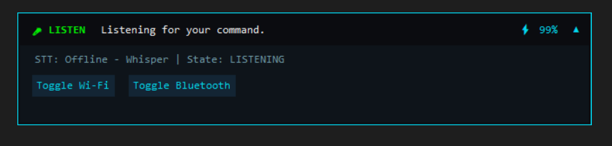

# 🚀 Sci-Fi Python Dashboard Template (Tkinter HUD)

A futuristic **JARVIS-style telemetry & system monitor dashboard** built in pure Python using Tkinter. Designed for AI assistants, cyber-decks, and custom desktop monitors.



## ✨ Features
* **Neon Cyber HUD Interface:** High-contrast dark theme with glowing cyan/blue sci-fi frames.
* **Live System Telemetry:** Real-time CPU, RAM, and network status monitoring.
* **Modular Architecture:** Easy to plug into your own Python AI / JARVIS voice assistant.
* **Zero Heavy Dependencies:** Runs smoothly on Windows & Linux.

## 🔥 Get the Full Animated Pro Version ($9)
Want the complete production-ready source code (`src/hud.py`), animated radar rings, custom sound effects, and full setup guide?

👉 **[Download Full Pro Template on Gumroad ($9)](https://ayushpatel705.gumroad.com/l/kavvql)**

## 🛠️ Quick Start (Lite Demo)
```bash
git clone [https://github.com/ayush-patel13/SciFi-Python-Dashboard-Template.git](https://github.com/ayush-patel13/SciFi-Python-Dashboard-Template.git)
cd SciFi-Python-Dashboard-Template
python demo_hud.py
